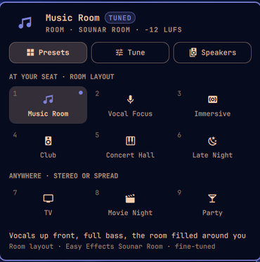
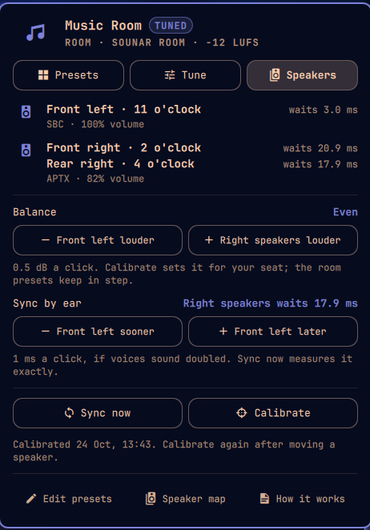

# Sounar

**Sound + arrange.** Turn the speakers you already have into one system that's arranged for where
you sit, and switch the whole arrangement with one command or one click.

<p align="center">
&nbsp; </p>

A **preset** sets three things at once:

- **How the speakers share the music.** The vocals stay anchored in the speaker you face, the
  speakers beside and behind you add the room, and every speaker plays the same bass, lined up
  so it lands together at your seat. Or every speaker plays as wired, or the whole song plays
  everywhere for a party.
- **Balance and delay.** A one-minute measurement with your computer's microphone evens the
  speakers out and lines them up for your seat, including Bluetooth speakers that each add
  their own delay.
- **Effects.** The [Easy Effects](https://github.com/wwmm/easyeffects) preset that goes with it,
  with song leveling on, so a quiet ballad and a loud club track play at a similar loudness.

Switching never interrupts the music, and nothing is measured again when you switch.

| Preset | Layout | For |
|---|---|---|
| Music Room | room | everyday music at your seat: vocals up front, full bass, the room filled around you |
| Vocal Focus | room | singers, acoustic, podcasts |
| Immersive | room | ambient, live sets, film scores |
| Club | room | afrobeats, amapiano, hip-hop, EDM |
| Concert Hall | room | classical and jazz |
| Late Night | room | low volume: clear vocals, no boom |
| TV, Movie Night | stereo | facing the TV |
| Party | spread | anywhere in the room |

Each preset can be fine-tuned live (vocal presence, bass, centre focus, room fill, ambience
delay, …), and you can add your own.

## What you need

- Linux with **PipeWire 1.4 or newer** and WirePlumber (most current distributions)
- **Two or more speakers**: Bluetooth, USB, the computer's own, HDMI. A speaker whose left and
  right jacks feed two separate boxes counts as two.
- **Python 3.11+** with NumPy
- A **microphone** at your seat for measuring (a laptop's built-in one is fine). Optional: you
  can balance and sync by ear instead.
- [Easy Effects](https://github.com/wwmm/easyeffects) 8 is recommended (EQ presets and song
  leveling). Without it, presets still arrange the speakers.

Any desktop works. On [Omarchy](https://omarchy.org) you also get a bar icon with a panel for
everything (the screenshots above) and menu entries.

## Quick start

```sh
git clone https://github.com/zane8n/sounar && cd sounar
./install.sh            # per user, no sudo; changes nothing about your sound yet
sounar setup            # finds your speakers, plays a soft tone on each, asks where each one sits
```

Setup asks where each speaker sits using a **clock face around your seat**: 12 is straight
ahead, 3 your right, 6 behind you and 9 your left. It then restarts PipeWire once (after
asking), creates a combined output called "Sounar", and offers to calibrate. After that:

```sh
sounar list             # the presets
sounar club             # switch
sounar vocal +0.5       # fine-tune the active preset
sounar menu             # a picker (Omarchy menu, Walker, Fuzzel, Rofi, Wofi, bemenu or dmenu)
sounar sync             # after a Bluetooth speaker reconnects (~15 s of chirps)
sounar help             # everything else
```

Update with `git pull && ./install.sh`; your setup, presets and calibration stay. Remove with
`sounar uninstall`.

## Setups

Sounar works from positions, not from particular speakers, so it fits many rooms. The
[example setups](setups/README.md) show some of them: a stereo pair, a pair plus a rear
speaker, two pairs, left-centre-right, a pair with a sub, and the room Sounar started in.
`sounar setup --example quad` starts from one of them.

Your room works and isn't there? [Share it](setups/README.md#share-yours). It helps the next
person with the same speakers.

## How it works

Each output runs a small filter graph inside PipeWire that Sounar rewrites live: no extra
latency, no restart, and the delays are exact to the sample. A background service (the guard)
puts things back after a speaker reconnects. Read more:

- [How it works](docs/how-it-works.md): the sound path, the guard, why Bluetooth needs a keep-alive
- [Layouts](docs/layouts.md): what each speaker plays, and the formulas
- [Measuring](docs/measuring.md): sync and calibrate
- [Presets](docs/presets.md): writing your own
- [status --json](docs/status-json.md): build a widget for your desktop
- [Troubleshooting](docs/troubleshooting.md)
- [Design](docs/design.md): the decisions behind it

## Contributing

Sounar is young, and every room is different. The easiest help is
[sharing your setup](https://github.com/zane8n/sounar/issues/new?template=share_setup.yml).
Bar widgets for other desktops (Waybar, GNOME, KDE) are very welcome, and so are presets and
distribution packages. See [CONTRIBUTING.md](CONTRIBUTING.md). The tests run without any
speakers.

Please follow the [code of conduct](CODE_OF_CONDUCT.md). Security issues:
[SECURITY.md](SECURITY.md).

## License

[MIT](LICENSE)
